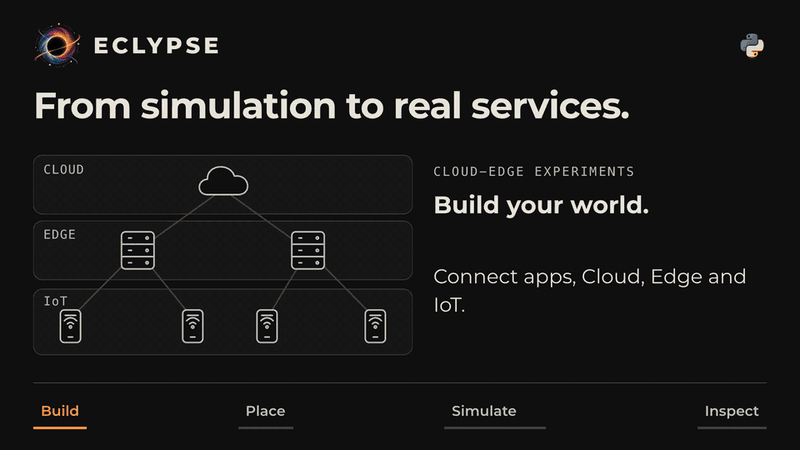

<p align="center">
<picture>
    <source media="(prefers-color-scheme: dark)" srcset="https://raw.githubusercontent.com/eclypse-org/eclypse/refs/heads/main/docs/_static/images/dark-transparent.png?">
</picture>
</p>


[](https://github.com/pre-commit/pre-commit)
[](https://codecov.io/github/eclypse-org/eclypse)
[](https://results.pre-commit.ci/latest/github/eclypse-org/eclypse/main)

**ECLYPSE** (**E**dge-**CL**oud p**Y**thon **P**latform for **S**imulated runtime **E**nvironments) is a Python framework for experimenting with deployment strategies in the cloud–edge continuum. Model service-based applications and infrastructures, decide where services run, and study how deployments behave as resources and conditions change.

ECLYPSE is designed for researchers and developers evaluating placement strategies and distributed application scenarios.

[](#quickstart)

## Key features

- **Build scenarios:** represent infrastructures and applications as resource-aware graphs, starting from [built-in builders](https://eclypse.readthedocs.io/en/latest/overview/concepts/builders/) or custom topologies.
- **Control placement:** use built-in or custom [placement strategies](https://eclypse.readthedocs.io/en/latest/overview/concepts/placement-strategy/) to map services onto infrastructure nodes.
- **Model change:** define [update policies](https://eclypse.readthedocs.io/en/latest/overview/concepts/update-policy/) and [events](https://eclypse.readthedocs.io/en/latest/overview/concepts/events/) for evolving resources, failures, workloads, and topology.
- **Inspect results:** collect built-in or custom metrics and query [reports](https://eclypse.readthedocs.io/en/latest/overview/getting-started/inspect-results/) as dataframes.
- **Run implemented services:** move from abstract scenarios to [remote emulation](https://eclypse.readthedocs.io/en/latest/overview/getting-started/remote-emulation/).

## Simulation and emulation

**Local simulation** models services as application graph nodes, without requiring service implementations. Use it to study placement, resource evolution, and deployment behaviour.

**Remote emulation** executes implemented services through Ray, with MPI-style message passing or REST-style communication. It requires Ray, remote-capable services, and remote execution configuration. See the [emulation guide](https://eclypse.readthedocs.io/en/latest/overview/advanced/emulation/) for setup and communication details.

## Installation

ECLYPSE is available on [PyPI](https://pypi.org/project/eclypse/) and requires **Python `>=3.11,<3.15`**. Install it with pip:

```bash
pip install eclypse
```

Or add it to a uv project:

```bash
uv add eclypse
```

See the [installation guide](https://eclypse.readthedocs.io/en/latest/overview/install/) for environment setup. The quickstart uses only the base package; remote emulation and other optional features may need additional dependencies.

## Quickstart

Save this as `quickstart.py`. It builds a 20-node infrastructure and a Sock Shop application, runs 20 simulation steps with random placement and a built-in CPU degradation policy, then reads the collected metrics.

```python
from pathlib import Path

from eclypse import policies
from eclypse.builders.application import get_sock_shop
from eclypse.builders.infrastructure import get_hierarchical
from eclypse.placement.strategies import RandomStrategy
from eclypse.simulation import Simulation, SimulationConfig

seed = 22
infrastructure = get_hierarchical(
    n=20,
    include_default_assets=True,
    update_policies=policies.degrade.reduce(
        factor=0.95,
        epochs=20,
        node_assets=["cpu"],
    ),
    seed=seed,
)
application = get_sock_shop(include_default_assets=True, seed=seed)

config = SimulationConfig(
    seed=seed,
    max_steps=20,
    include_default_metrics=True,
    default_strategy=RandomStrategy(seed=seed),
    path=Path.home() / "quickstart-results",
)

simulation = Simulation(infrastructure, simulation_config=config)
simulation.register(application)
simulation.run()

application_frame = simulation.report.application()
service_frame = simulation.report.service()
print("Application report empty:", application_frame.empty)
print("Service report empty:", service_frame.empty)
print(application_frame.head())
```

The built-in `policies.degrade.reduce` policy gradually reduces node CPU values by 5% over 20 evolution steps. This models infrastructure degradation without writing a custom policy.

Run it:

```bash
python quickstart.py
```

After the runtime logs, the first two lines confirm that metrics were collected:

```text
Application report empty: False
Service report empty: False
```

The application dataframe preview follows. `RandomStrategy` is a baseline, not a guarantee of feasible placement: this scenario can log `Path not found` and `Resetting placement` warnings. Non-empty reports confirm metric collection, not successful deployment; inspect the metric values when comparing strategies. Reports are written under `~/quickstart-results` in your home directory; if that directory already exists, ECLYPSE chooses a timestamped path instead. The default report backend returns pandas dataframes.

To adapt this experiment, replace `RandomStrategy` with your placement strategy, change the infrastructure builder, or add update policies. Continue with [running a local simulation](https://eclypse.readthedocs.io/en/latest/overview/getting-started/minimal-local-run/) and [inspecting results](https://eclypse.readthedocs.io/en/latest/overview/getting-started/inspect-results/).

## Examples

Follow these examples in order, or choose the scenario closest to your experiment:

- [Off-the-shelf](https://eclypse.readthedocs.io/en/latest/overview/examples/off_the_shelf/): compose a local simulation from built-in builders, policies, and placement logic.
- [User distribution](https://eclypse.readthedocs.io/en/latest/overview/examples/user_distribution/): add a custom metric and update policy driven by changing user distributions.
- [Grid analysis](https://eclypse.readthedocs.io/en/latest/overview/examples/grid_analysis/): compare topologies, policies, and strategies with a Ray Tune sweep.
- [Sock Shop](https://eclypse.readthedocs.io/en/latest/overview/examples/sock_shop/): explore a microservices application with MPI and REST variants.

Runnable source is available in [`examples/`](examples/). Individual examples may need additional dependencies or remote setup; check their guides before running them.

## Documentation

- [Getting started](https://eclypse.readthedocs.io/en/latest/overview/getting-started/): installation, first run, results, and remote emulation.
- [Core concepts](https://eclypse.readthedocs.io/en/latest/overview/concepts/): topology, assets, builders, placement, policies, and events.
- [API reference](https://eclypse.readthedocs.io/en/latest/reference/eclypse/): public modules and interfaces.
- [Changelog](CHANGELOG.md): release history.

## Contributing

See [CONTRIBUTING.md](CONTRIBUTING.md) for issue templates, development setup, tests, documentation checks, and pull request guidelines.

## Publication

ECLYPSE is described and assessed in:

> Jacopo Massa, Valerio De Caro, Stefano Forti, Patrizio Dazzi, Davide Bacciu, Antonio Brogi<br>
> [**ECLYPSE: a Python Framework for Simulation and Emulation of the Cloud-Edge Continuum**](https://doi.org/10.1002/smr.70081), <br>
> Journal of Software: Evolution and Process, 2026.

If you want to cite ECLYPSE in your work, you can use the following BibTeX entry:

```bibtex
@article{massa2026eclypse,
  title     = {{ECLYPSE: A Python Framework for Simulation and Emulation of the Cloud-Edge Continuum}},
  author    = {Massa, Jacopo and De Caro, Valerio and Forti, Stefano and Dazzi, Patrizio and Bacciu, Davide and Brogi, Antonio},
  journal   = {Journal of Software: Evolution and Process},
  volume    = {38},
  number    = {1},
  pages     = {e70081},
  year      = {2026},
  month     = {1},
  doi       = {10.1002/smr.70081},
}
```

## License

ECLYPSE is released under the [MIT License](LICENSE).

## Maintainers

ECLYPSE is maintained by [Jacopo Massa](https://github.com/jacopo-massa) and
[Valerio De Caro](https://github.com/vdecaro).

## Contact Us

If you want to get in touch with us, [drop us an e-mail](mailto:jacopo.massa@di.unipi.it,valerio@valeriodecaro.com?subject=[ECLYPSE]%20Request%20for%20information)!
