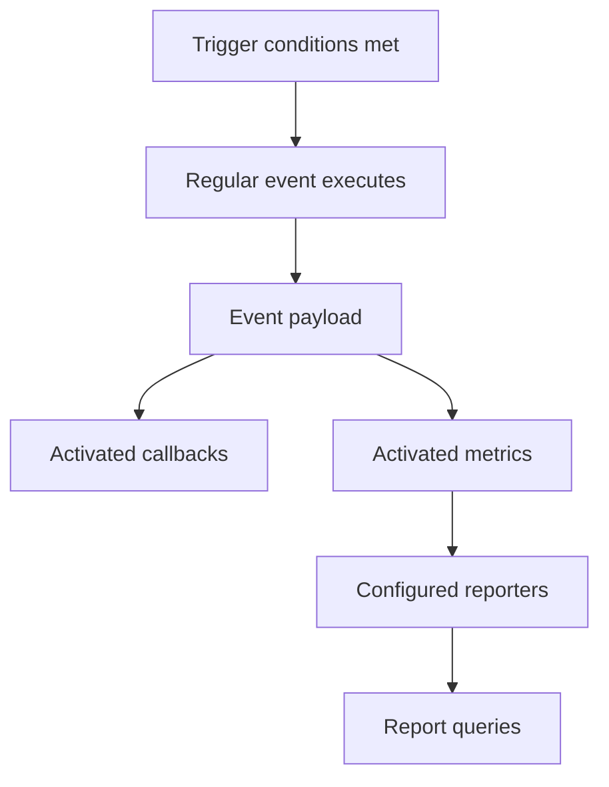

# Events

In ECLYPSE, the simulation workflow is fully driven by **events**.
Events define units of logic that are executed when one or more **triggers** activate.
They can be used to update the simulation state, compute metrics, or execute callbacks.

An event can be periodic, conditionally activated, or triggered by another event.



An update event can apply configured policies. Callbacks and metrics run after
the event that activates them. This diagram shows their roles, not a fixed
ordering between individual callbacks and metrics.


ECLYPSE distinguishes between an event's **role** and its **type**:

- the **role** defines *how the event participates in the workflow*,
- the **type** defines *which objects are passed to the event logic*.

## Roles: events, callbacks, and metrics

Every [EclypseEvent][eclypse.workflow.event.event.EclypseEvent] has an
[EventRole][eclypse.workflow.event.role.EventRole].

| Role | Meaning |
| --- | --- |
| [EVENT][eclypse.workflow.event.role.EventRole.EVENT] | The default role for regular workflow logic. These events are triggered directly by the simulation or by other triggers, and their payload can be consumed by downstream callbacks and metrics. |
| [CALLBACK][eclypse.workflow.event.role.EventRole.CALLBACK] | A post-event hook. It runs immediately after the event that activated it and has access to that triggering event through `triggering_event` and `**event_data`. Callbacks are primarily useful for chaining logic or reacting to another event. |
| [METRIC][eclypse.workflow.event.role.EventRole.METRIC] | A reportable post-event hook. Metrics share the same execution model as callbacks, but they are intended to produce rows that reporters can persist and that [Report][eclypse.report.report.Report] can load afterwards. |

In practice:

- use a regular event when you want to drive the workflow,
- use a callback when you want post-event logic that is mainly internal to the
  simulation,
- use a metric when you want post-event logic whose output should be reported.

## Defining an Event

An event can be defined by:

- decorating a function or a class with a `__call__` method
- subclassing [EclypseEvent][eclypse.workflow.event.event.EclypseEvent] and overriding the `__call__` method

!!! note "See also"

    Events are activated by **Triggers**, which define *when* and *under what
    conditions* an event should fire, thus at least one trigger must be defined
    for an event to be activated.

    You can use built-in triggers (e.g., cascade or periodic) or define your own.

    See the [Triggers](../advanced/triggers.md) page for more on how to configure and combine them.

### Event Parameters

Here are the most relevant parameters to control event behaviour:

- `name` *(str)*: The event name.
- `event_type`: The context where the event executes, such as `"node"` or
  `"service"`. It can also be `None`.
- `triggers`: A list of [Trigger][eclypse.workflow.trigger.trigger.Trigger]
  objects, modelling the conditions that can activate the event.
- `activates_on`: A more compact way to specify triggers, using a list of strings and tuples
- `trigger_condition`: Whether all triggers must activate or just one (*"all"* or *"any"*).
- `role`: The workflow role of the event, chosen from
  [EventRole][eclypse.workflow.event.role.EventRole].
- `remote`: If `True`, the event is executed on remote infrastructure nodes or services.
- `report`: Types of reports to generate for this event, such as `"csv"` or `"json"`.
  In practice, this is mainly relevant for metrics.
- `verbose`: If `True`, log detailed event triggering and firing info.

The event **type** determines the arguments passed to its logic function.
The role does not change the signature; it changes *when* the event runs and *how*
its output is interpreted.

Specifically:

| Event Type | Parameters |
| --- | --- |
| simulation (or None) | `triggering_event` ([EclypseEvent][eclypse.workflow.event.event.EclypseEvent]) |
| application | `application` ([Application][eclypse.graph.application.Application])<br>`placement` ([Placement][eclypse.placement.placement.Placement])<br>`infrastructure` ([Infrastructure][eclypse.graph.infrastructure.Infrastructure])<br>`**event_data` (*Dict[str, Any]*) |
| service | `service_id` (*str*)<br>`requirements` (*Dict[str, Any]*)<br>`placement` ([Placement][eclypse.placement.placement.Placement])<br>`infrastructure` ([Infrastructure][eclypse.graph.infrastructure.Infrastructure])<br>`**event_data` (*Dict[str, Any]*) |
| service (with `remote=True`) | `service` ([Service][eclypse.remote.service.service.Service]) |
| interaction | `source_id` (*str*)<br>`target_id` (*str*)<br>`requirements` (*Dict[str, Any]*)<br>`placement` ([Placement][eclypse.placement.placement.Placement])<br>`infrastructure` ([Infrastructure][eclypse.graph.infrastructure.Infrastructure])<br>`**event_data` (*Dict[str, Any]*) |
| infrastructure | `infrastructure` ([Infrastructure][eclypse.graph.infrastructure.Infrastructure])<br>`placement_view` ([PlacementView][eclypse.placement.view.PlacementView])<br>`**event_data` (*Dict[str, Any]*) |
| node | `node_id` (*str*)<br>`resources` (*Dict[str, Any]*)<br>`placements` (*Dict[str,* [Placement][eclypse.placement.placement.Placement] *]*)<br>`infrastructure` ([Infrastructure][eclypse.graph.infrastructure.Infrastructure])<br>`placement_view` ([PlacementView][eclypse.placement.view.PlacementView])<br>`**event_data` (*Dict[str, Any]*) |
| link | `source_id` (*str*)<br>`target_id` (*str*)<br>`resources` (*Dict[str, Any]*)<br>`placements` (*Dict[str,* [Placement][eclypse.placement.placement.Placement] *]*)<br>`infrastructure` ([Infrastructure][eclypse.graph.infrastructure.Infrastructure])<br>`placement_view` ([PlacementView][eclypse.placement.view.PlacementView])<br>`**event_data` (*Dict[str, Any]*) |

!!! note

    `**event_data` contains the payload produced by the event that triggered the
    current callback or metric. It is therefore most relevant for post-event roles.

When an event is defined for a specific component type, it is automatically executed **once for each matching component** in the model.
For instance, an `application` event is called once per application in the simulation; a `node` event is called once per infrastructure node, ...

As a result, the event logic should be written as if it handles a **single instance** of the component, not a collection.
This behavior applies to all events and is especially relevant when defining [metrics](../advanced/reporting.md).

Regular events, callbacks, and metrics can all use the same event types. For example:

- an `application` event can mutate application-level state,
- an `application` callback can react to the payload of another event,
- an `application` metric can return application-level report rows.

### Scheduled event decorators { #event-decorator }

The public decorator API exposes the common scheduling shapes directly:

- [`@every(steps=...)`][eclypse.workflow.event.decorator.every] for periodic events,
- [`@after(step=...)`][eclypse.workflow.event.decorator.after] for delayed events,
- [`@once_at(step=...)`][eclypse.workflow.event.decorator.once_at] for one-shot events.

These decorators allow you to register both functions and callable classes as
**simulation events**. You can apply them to:

- a **function**, which becomes the logic of the event,
- a **class** with a `__call__` method, to maintain internal state.

```python title="Example: Decorating a function"
from eclypse.workflow.event import every

@every(steps=5, name="step_logger", event_type="simulation")
def log_step():
    print("Simulation step")
```

```python title="Example: Decorating a class"
from eclypse.workflow.event import once_at

@once_at(step=10, name="step_counter", event_type="simulation")
class StepCounter:
    def __init__(self):
        self.counter = 0

    def __call__(self):
        self.counter += 1
        print(f"Step: {self.counter}")
```

## Callbacks

Callbacks use the same scheduled decorators as regular events, but with a
different role:

```python title="Example: Defining a callback"
from eclypse.workflow.event import EventRole, after

@after(
    step=0,
    name="after_step",
    event_type="simulation",
    activates_on=["step"],
    role=EventRole.CALLBACK,
)
def after_step(triggering_event):
    print(f"{triggering_event.name} produced {triggering_event.data}")
```

Callbacks are best suited for:

- chaining workflow logic after another event,
- deriving transient information from the triggering event,
- reacting to another event without necessarily reporting the result.

If the scheduling decorators do not fit a particular workflow, define a custom
event by subclassing [EclypseEvent][eclypse.workflow.event.event.EclypseEvent] and
overriding `__call__`. This gives full control over construction, state, and
trigger configuration:

```python title="Example: Custom event class"
from eclypse.workflow.event import EclypseEvent
from eclypse.workflow.trigger import CascadeTrigger

class StepAudit(EclypseEvent):
    def __init__(self):
        super().__init__(
            name="step_audit",
            event_type="simulation",
            triggers=[CascadeTrigger("step")],
        )

    def __call__(self, triggering_event):
        return {"source": triggering_event.name}
```

## Metrics { #event-metrics }

Metrics are a specialized type of event used to collect simulation data at
different levels of abstraction (e.g., per iteration, per application, per
node). Under the hood they are post-event events with the
[METRIC][eclypse.workflow.event.role.EventRole.METRIC] role, but the
recommended public API is the set of convenience decorators in
[eclypse.report.metrics][eclypse.report.metrics].

Compared with callbacks, metrics differ mainly in their intent:

- callbacks are primarily workflow hooks,
- metrics are reporting hooks and are meant to produce persistable output.

For the practical metric API, built-in report types, custom reporters, and
report loading, see [Reporting](../advanced/reporting.md).

!!! note "See also"

    - [Reporting](../advanced/reporting.md)
    - [Triggers](../advanced/triggers.md)
