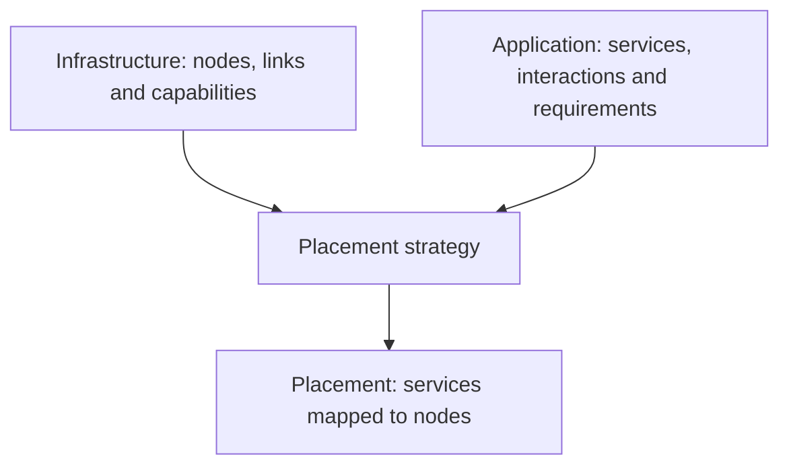

# Infrastructure and Application(s)

In ECLYPSE, both the **infrastructure** and **applications** are modelled as graphs enriched with resource-related attributes ([assets](assets.md)) and dynamic behaviour (update policies). These are represented using two core classes:

- [Infrastructure][eclypse.graph.infrastructure.Infrastructure] -- models a multi-layered infrastructure, made of nodes and links with their capabilities
- [Application][eclypse.graph.application.Application] -- models a multi-service application, made of services and interactions with their requirements

The two classes share many structural similarities, but differ in purpose and in the parameters used at initialisation.



Placement matches application requirements against infrastructure capabilities.


=== "Infrastructure"

    ```python
    from eclypse import policies
    from eclypse.graph.infrastructure import Infrastructure

    infrastructure = Infrastructure(
        infrastructure_id="infra",
        include_default_assets=True,
        update_policies=[
            policies.failure.availability_flap(0.01, up_probability=0.2),
            policies.distribution.uniform(
                node_assets=["cpu", "ram"],
                edge_assets=["latency", "bandwidth"],
                node_distribution=(0.95, 1.05),
                edge_distribution=(0.95, 1.05),
            ),
        ],
        resource_init="min",
        seed=42,
    )
    ```

    **Key parameters:**

    - `infrastructure_id`: identifier of the infrastructure
    - `update_policies`: list of [update policies](update-policy.md) for infrastructure resources
    - `node_assets` / `edge_assets`: available capabilities ([asset](assets.md) values) of nodes and links
    - `include_default_assets`: include the built-in CPU, RAM, storage, availability, latency, and bandwidth assets
    - `resource_init`: initialisation of resources not given explicitly (*min*, *max* or *asset_init*, see [assets](assets.md))
    - `seed`: random seed for reproducibility
    - `path_assets_aggregators`: aggregators for *each link asset* evaluation across paths

=== "Application"

    ```python
    from eclypse import policies
    from eclypse.graph.application import Application

    application = Application(
        application_id="app",
        include_default_assets=True,
        update_policies=[
            policies.after(
                50,
                policies.degrade.reduce(
                    factor=0.6,
                    epochs=200,
                    node_assets=["cpu", "ram"],
                    edge_assets=["bandwidth"],
                ),
            ),
            policies.after(
                50,
                policies.degrade.increase(
                    factor=1.6667,
                    epochs=200,
                    edge_assets=["latency"],
                ),
            ),
        ],
        requirement_init="min",
        seed=42,
        flows=[["frontend", "worker"]],
    )
    ```

    **Key parameters:**

    - `application_id`: identifier of the application. Defaults to `"Application"`
    - `update_policies`: list of [update policies](update-policy.md) for application requirements
    - `node_assets` / `edge_assets`: resource requirements ([asset](assets.md) values) of services and links
    - `include_default_assets`: include the built-in requirement assets
    - `requirement_init`: initialisation of requirements not given explicitly (*min*, *max* or *asset_init*, see [assets](assets.md))
    - `seed`: random seed for reproducibility
    - `flows`: list of service chains or communication flows

These classes inherit from a common base ([AssetGraph][eclypse.graph.asset_graph.AssetGraph]) and can be extended or composed via utility functions and default builders.

## Defining the topologies { #define-topology }

Once you have defined an Infrastructure or an Application object, you can incrementally add **nodes** (or services) and **edges** (or interactions) to describe its structure.

Both classes expose two methods:

- [add_node][eclypse.graph.asset_graph.AssetGraph.add_node] — to add a node or service
- [add_edge][eclypse.graph.asset_graph.AssetGraph.add_edge] — to add a link or interaction

These methods allow you to associate assets and automatically validate their values, according to the asset definitions you provided during initialisation.

=== "Infrastructure"

    ```python
    from eclypse.graph.infrastructure import Infrastructure
    from eclypse.graph.assets.defaults import cpu, ram, latency, bandwidth

    infra = Infrastructure(
        infrastructure_id="my-infra",
        node_assets={"cpu": cpu(), "ram": ram()},
        edge_assets={"latency": latency(), "bandwidth": bandwidth()},
        path_assets_aggregators={"latency": sum, "bandwidth": min},
        resource_init="min",  # these assets have no initialiser
    )

    # Add two compute node
    infra.add_node("node-1", cpu=4.0, ram=8.0)
    infra.add_node("node-2", cpu=8.0, ram=16.0, strict=False)

    # Add a link with latency and bandwidth
    infra.add_edge(
        "node-1", "node-2",
        latency=10.0,
        bandwidth=100.0,
        symmetric=True  # optional bidirectional link
    )
    ```

    - `strict=True` (default): raises an error if asset values are inconsistent
    - `symmetric=True`: adds the edge in both directions

=== "Application"

    ```python
    from eclypse.graph.application import Application
    from eclypse.graph.assets.defaults import cpu, ram, latency, bandwidth

    app = Application(
        application_id="my-app",
        node_assets={"cpu": cpu(), "ram": ram()},
        edge_assets={"latency": latency(), "bandwidth": bandwidth()},
        requirement_init="min",  # these assets have no initialiser
    )

    # Add a service with specific resource requirements
    app.add_node("service-A", cpu=1.0, ram=0.5)
    app.add_node("service-B", cpu=2.0, ram=1.0, strict=False)

    # Add a directional communication between services
    app.add_edge(
        "service-A", "service-B",
        latency=5.0,
        bandwidth=10.0,
        symmetric=False
    )
    ```

    - `strict=True` (default): raises an error if requirements are outside defined bounds
    - `symmetric=False` (default): adds the edge in one direction only

    If you're building an application to run in **emulation mode** rather than *simulation*,
    each service must be implemented with actual logic and remote execution support.

    See the [Emulation guide](../advanced/emulation/index.md) for details.

!!! note

    All assets passed to [add_node][eclypse.graph.asset_graph.AssetGraph.add_node] or [add_edge][eclypse.graph.asset_graph.AssetGraph.add_edge] are checked against the declared asset definitions.
    If validation fails and `strict` is `True`, an exception is raised. Otherwise, a warning is logged.

## Default builders

ECLYPSE provides several built-in builder functions that allow you to quickly
instantiate commonly used topologies and reference applications.
They return mutable [Application][eclypse.graph.application.Application] or
[Infrastructure][eclypse.graph.infrastructure.Infrastructure] objects with sensible
asset defaults and, for applications, representative flows.

```python
from eclypse.builders.application import get_sock_shop
from eclypse.builders.infrastructure import get_fat_tree

infra = get_fat_tree(k=4, include_default_assets=True)
app = get_sock_shop(include_default_assets=True)
```

!!! tip

    Builders are useful for prototyping or benchmarking standard scenarios. All
    returned graphs are mutable and can be extended using the
    [standard interface](#define-topology). See [Builders](builders.md) for the
    available builder families.
